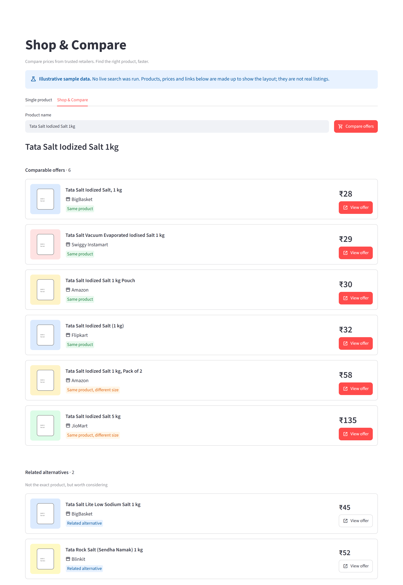
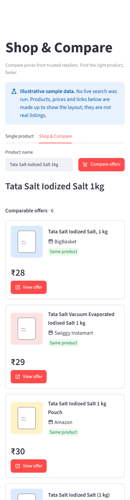
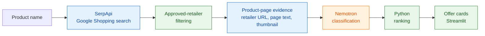

# Shop & Compare

[](https://github.com/shouryacha/Shop-and-Compare/actions/workflows/ci.yml)

[](LICENSE)


**Compare prices from trusted retailers. Find the right product, faster.**

Shop & Compare takes a product name, finds listings on Google Shopping, keeps only approved Indian
retailers, and asks an LLM (NVIDIA Nemotron) whether each listing is really the product you meant.
Plain Python then ranks the results and shows them as price-focused offer cards.

- **Trusted retailers only.** An explicit allowlist with exact name matching; unknown sellers never reach the model.
- **Semantic matching.** Same product, same product in another size, related alternative, or something else entirely.
- **Evidence, not guesses.** Each candidate is judged on its title, its retailer page text and its thumbnail.
- **Deterministic results.** Ordering, de-duplication and price handling are ordinary, tested Python.
- **Honest failures.** Offers that could not be verified are counted, never silently shown or dropped.
- **Hardened fetching.** Retailer pages are fetched through an SSRF guard (no private, loopback or metadata addresses).

## Screenshots

> Both screenshots show **illustrative sample data** produced by the offline demo
> (`scripts/demo_app.py`). No live search was run; the products, prices and links are made up and
> are not real listings.

| Desktop | Phone width |
|---|---|
|  |  |

## Features

**Shop & Compare** (main tab)
- One search, then up to 10 approved-retailer candidates are examined.
- Offers are grouped into *Comparable offers* (same product, or same product in another size) and *Related alternatives*.
- Each card shows the product image, title, retailer name, a large price and a **View offer** button.
- Unrelated listings are hidden but counted ("3 unrelated listings hidden").

**Single product** (second tab, also `python run.py`)
- Retrieves verified, high-resolution product images for one product name.
- Tries Amazon, then Google Shopping, then a Google Images fallback; a vision model verifies each candidate image against the name.
- Saves the full gallery and a `metadata.json` under `images/<product>/`.

## How it works



<sub>Green: deterministic Python. Orange: LLM judgement. Blue: external data.</sub>

1. **Search.** One Google Shopping query through SerpApi (India).
2. **Filter.** Only sellers on the approved-retailer allowlist survive (`shopping_retailers.py`). The first 10 survivors, in Google's order, continue.
3. **Evidence.** One `google_immersive_product` call per candidate resolves the direct retailer URL. The page is fetched through the SSRF guard and a short text excerpt is extracted. If the page cannot be fetched or read, the title and thumbnail are used instead.
4. **Classify.** Nemotron labels each candidate `same_product`, `same_product_different_size`, `related_product` or `different_variant`, in batches of 5 with retries.
5. **Rank.** Python orders offers by label, then price, de-duplicates per retailer, and the UI renders the cards.

### The approved-retailer allowlist

Only offers whose Google Shopping seller name exactly matches a known alias are processed. Matching
is exact after normalization, never substring-based, so "Shopsy By Flipkart" is not mistaken for
Flipkart. The list covers Amazon, Flipkart, Myntra, Blinkit, Zepto, Nykaa, BigBasket, JioMart,
Swiggy Instamart, DMart, Tata CLiQ, Croma, Reliance Digital, Vijay Sales, AJIO, FirstCry, Purplle,
Tata 1mg, Decathlon, Apple and Samsung. Add a retailer by extending `APPROVED_RETAILERS`.

### Design decisions

- **Python decides *what is allowed and in what order*; Nemotron decides *what the product is*.**
  Whether a seller is trusted, how offers are sorted and how duplicates are handled are exact rules
  that should be reproducible and unit-tested, so they are plain Python. Whether "Tata Salt Lite" is
  the same product as "Tata Salt", or whether a 2 x 1 kg pack matches a 1 kg request, is a semantic
  judgement that string rules handle badly, so that is the only job given to the model.
- **The model never sorts or picks a winner.** It labels each candidate independently; ranking is
  derived from those labels afterwards.
- **A failed classification is not a mismatch.** Infrastructure failures are reported as
  "couldn't be verified" rather than treated as matches or non-matches.
- **Page text is untrusted data.** It is truncated, placed on a labelled line, and the prompt
  instructs the model to ignore any instructions inside it. The fetch itself refuses internal
  addresses (see `utils/safe_http.py`).
- **Bounded cost.** One search plus at most 10 URL lookups per comparison, and a fixed candidate cap.

## Prerequisites

- Windows 10 or 11 (other platforms should work but are not documented here)
- Python 3.12 or newer
- A [SerpApi](https://serpapi.com) API key
- An [NVIDIA Build](https://build.nvidia.com) API key

## Setup (Windows)

In PowerShell, from the project folder:

```powershell
python -m venv .venv
.\.venv\Scripts\Activate.ps1
python -m pip install --upgrade pip
python -m pip install -e .
python -m pip install --group dev
Copy-Item .env.example .env
```

If PowerShell blocks `Activate.ps1`, run `Set-ExecutionPolicy -Scope CurrentUser RemoteSigned` once,
or use `.venv\Scripts\activate.bat` from `cmd`. With [uv](https://docs.astral.sh/uv/), `uv sync` works too.

### Configuration

Edit `.env` and replace the placeholders. The file is git-ignored; only `.env.example` is committed.

| Variable | Required | Purpose |
|---|---|---|
| `NVIDIA_API_KEY` | Yes | NVIDIA Build key for the Nemotron models |
| `PIR_SERPAPI_API_KEY` | Yes | SerpApi key (Google Shopping, link resolution, Google Images) |
| `PIR_REQUEST_TIMEOUT_SECONDS` | No | Timeout for SerpApi requests (default 15, example file uses 30) |

## Run

```powershell
streamlit run app.py
```

Open `http://localhost:8501`, go to **Shop & Compare**, enter a product such as
`Tata Salt Iodized Salt 1kg` and press **Compare offers**. Each search makes live SerpApi, NVIDIA and
retailer requests and spends SerpApi credits.

To explore the interface **without keys or credits**, run the offline demo on sample data:

```powershell
streamlit run scripts/demo_app.py
```

The command-line version of the Single product pipeline is `python run.py`.

## Test and lint

```powershell
python -m pytest
python -m ruff check .
python -m ruff format --check .
python -m mypy .
```

All four run in CI on Python 3.12, 3.13 and 3.14. The tests are fully offline: `tests/conftest.py`
installs a guard that fails any test that opens a connection to a non-local host, and providers,
DNS and sockets are faked.

## Limitations

- **Google Shopping results are volatile.** Sellers, prices and ordering change between runs, and
  some listings lack a price or a direct retailer link. Only the first 10 approved candidates are
  examined, so a good offer further down Google's list can be missed.
- **Retailer pages may not expose product text.** Some sites block automated requests or render
  content with JavaScript. Classification then relies on the listing title and thumbnail.
- **NVIDIA rate limits.** Requests are occasionally throttled or fail. The app retries, but a batch
  that still fails is reported as "couldn't be verified".
- **Latency.** A comparison makes many sequential and batched network calls and can take a while.
- **Prices are not live.** They are what Google Shopping showed at search time and are not
  re-checked on the retailer's site.
- **LLM judgement is imperfect.** Brand-only or very generic queries, and borderline pack-size
  differences, can be classified inconsistently.
- **India only.** Searches target `google.co.in` and the allowlist is Indian retailers.
- **Image downloads are not yet SSRF-guarded.** Card thumbnails and Single product gallery images
  are downloaded with the older downloader; only retailer page fetching goes through the guard.

## Project layout

| Path | Role |
|---|---|
| `app.py` | Streamlit UI |
| `shopping_comparison_stage.py` | Shop & Compare orchestration and ranking |
| `shopping_retailers.py` | Approved-retailer allowlist |
| `product_page_text.py`, `utils/safe_http.py` | Page-text extraction and the SSRF-safe fetcher |
| `classifier/nemotron.py`, `prompts.py` | Nemotron client and prompts |
| `search/` | SerpApi search and retailer adapters |
| `retailer_gallery_stage.py`, `selection_stage.py`, `verification_overrides.py` | Single product pipeline |
| `run.py` | CLI and composition root |
| `scripts/demo_app.py` | Offline sample-data demo |
| `tests/` | Offline test suite |

See [HANDOFF.md](HANDOFF.md) for architecture notes and [CLAUDE.md](CLAUDE.md) for contributor rules.

## License

[MIT](LICENSE)
